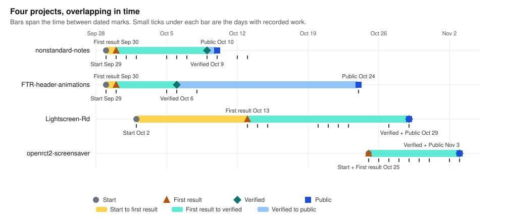

# Owen Gruebmeyer-Mulqueen

Software engineer
B.S. Computer Science (Regis University).
Two years on Azure data and application systems at Chevron, 2023 to 2025.

Everything below was built solo with LLM coding tools. My work is the planning, orchestration, and validation: setting the objectives and parameters, directing the model's workflows in parallel, and testing instead of trusting the output.

## Project timelines

Bars span the time between dated milestones, not hours worked; the ticks mark the days with recorded work.

## Projects

| Project | What it is | How it was verified |
|---|---|---|
| [FTR-header-animations](https://github.com/Ogrueb/FTR-header-animations) | The six Windows file-operation progress animations, decoded from the undocumented `FTR` resource format in shell32 and re-rendered by an independent renderer with two rendering models (geometric, and GDI+-faithful). Python. | Frame-by-frame comparison against 1:1 screen recordings on Vista, 7 and 10: median error 1.0 to 1.6 levels out of 255 on lossless captures, with no fitting. |
| [Lightscreen-Rd](https://github.com/Ogrueb/Lightscreen-Rd) | A maintained fork of the Lightscreen screenshot tool, carried from Qt 5 to Qt 6.8 and CMake: mixed-DPI capture, a configurable uploader, a PNG optimization queue. C++. | QtTest suite; CI on Windows and Linux for every change; a release workflow that publishes a runnable build. |
| [openrct2-screensaver](https://github.com/Ogrueb/openrct2-screensaver) | A screensaver mode for OpenRCT2: engine patches (C++) adding the mode and background park loading, a plugin (TypeScript) driving the camera and interface, and a generator (Python) that picks views per park. | Engine built by GitHub Actions against the pinned v0.5.6 release; the plugin falls back cleanly on an unpatched engine. |
| [nonstandard-notes](https://github.com/Ogrueb/nonstandard-notes) | An offline-first Android build of Standard Notes as an ordered series of ten patches over a pinned upstream commit, with network isolation and offline licensing. TypeScript. | Each patch is one reviewable commit; the README states exactly what does not work and why. |

Write-up on catching the model's errors in these projects: [Testing instead of trusting](testing-instead-of-trusting.md).

Contact: ogrueb@gmail.com · [LinkedIn](https://www.linkedin.com/in/ogrueb)
